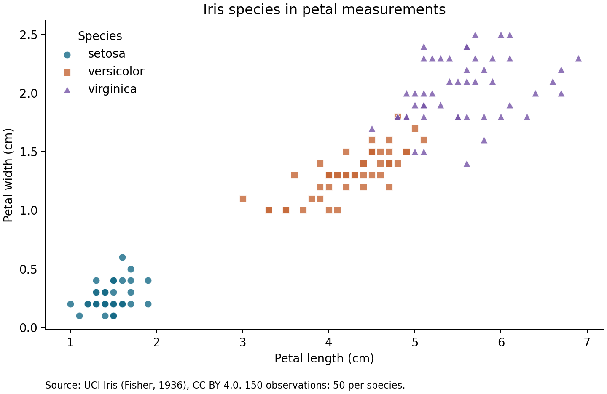

# Which Iris measurements distinguish species better?

A reproducible exploratory data analysis for CISC7204 Practice 09.

## Research question
Do petal length and width distinguish the three Iris species more clearly than sepal length and width?

## Dataset and permissions
Source: [UCI Iris](https://archive.ics.uci.edu/dataset/53/iris), Fisher, R. (1936). Iris [Dataset]. UCI Machine Learning Repository. DOI: [10.24432/C56C76](https://doi.org/10.24432/C56C76).

The dataset is distributed under [CC BY 4.0](https://creativecommons.org/licenses/by/4.0/), which permits reuse and redistribution with attribution. The original `iris.data` file from UCI is included without changes, downloaded on 16 October 2026. UCI documents differences between some records and Fisher's original article; this project analyzes the downloaded UCI version as provided.

There are 150 observations, 50 for each species, with four measurements in centimetres. No personal data is included. See `summary.json` for missing values, duplicate counts and the data file's SHA-256 checksum. Duplicate rounded measurements are retained because matching measurements do not establish that two flowers are the same observation.

## Methods and tools
Python, pandas, Matplotlib and scikit-learn. The analysis checks dimensions, class balance and missing data; produces species-level means and two scatter plots; and compares logistic regression using two sepal features versus two petal features. Both comparisons use the same five stratified folds, shuffled with seed 42. Standardization is fitted inside each training fold using a pipeline to avoid leakage. Accuracy is descriptive; folds are not independent replications or confidence intervals. The majority-class baseline is 33.3% because classes are balanced.

## Visual findings


Setosa is visually separated in petal measurements; versicolor and virginica overlap around their boundary. Petal measurements are useful but do not perfectly separate every observation.


Sepal measurements show greater overlap, especially between versicolor and virginica. The computed comparison is recorded in [the results report](findings.md).

Five-fold mean accuracy: **95.3% for petals** versus **81.3% for sepals**, using the same splits. See `findings.md` for individual fold results and interpretation.

## Limitations and next steps
This is a small, historical, balanced teaching dataset. Accuracy on these folds does not establish performance on flowers collected in another setting. Exploratory comparison on one dataset is not a causal result. Next steps include evaluating an independent dataset, examining misclassified examples, and reporting sensitivity to different splits.

## Reproduce
Use Python 3.12. From the repository root:

```sh
python -m venv .venv
# Windows PowerShell:
.venv\Scripts\Activate.ps1
# macOS/Linux instead: source .venv/bin/activate
python -m pip install -r requirements.txt
python analysis.py
```

The script reads the included data without network access and regenerates `petal_scatter.png`, `sepal_scatter.png`, `species_means.csv`, and `summary.json`. Package installation requires internet access. Version details are included in the summary. Run these commands from a clean environment for reproducibility.

## Organization
- `analysis.py`: complete runnable analysis.
- `iris.data`: attributed source data.
- `petal_scatter.png`, `sepal_scatter.png`: generated visualizations.
- `summary.json`, `species_means.csv`, `findings.md`: computed results and interpretation.
- `requirements.txt`: pinned dependencies.

## AI assistance
Prepared with assistance from OpenAI Codex for code, documentation, visualization and website drafting. The student should review, understand and verify the submitted work. No peer feedback is claimed until it is actually received.

